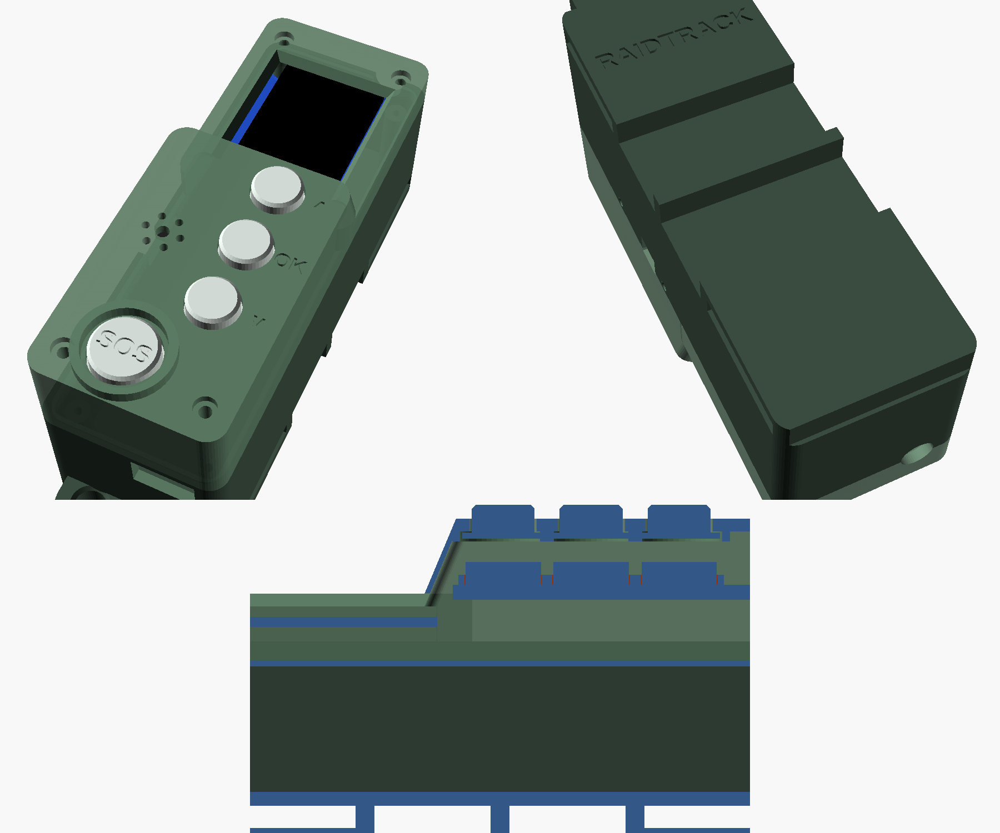

# Caixa RaidTrack — T-Beam Supreme

Caixa para usar o rádio **na vertical**:
- antena e ecrã em cima;
- teclado em baixo: ▲ · OK · ▼, mais o **SOS** grande com anel de proteção;
- besouro atrás de uma grelha;
- USB-C em baixo, para carregar.

Nas costas tem **dois passadores para fita de 25 mm** (velcro ou fita com fivela, para a alça da mochila, o cinto ou MOLLE) e, em baixo, uma **argola grossa** para um mosquetão ou cordão de segurança.

Medidas ≈ **38 × 108 × 50 mm**, sem contar com a antena nem com a argola.
As medidas da placa vêm do modelo 3D e do desenho oficiais da LilyGO, com a placa centrada.

| Ficheiro | O que é | Como imprimir |
|---|---|---|
| `caixa.stl` | fundo (placa + bateria 18650), passadores e argola | costas na mesa, como está; os passadores imprimem-se em ponte, sem suportes |
| `tampa.stl` | frente com ecrã, furos das teclas, grelha do besouro | frente para cima, com suportes "árvore" **só por dentro** |
| `suporte.stl` | placa que segura os 4 botões por baixo do teclado | como está; não precisa de suportes |
| `teclas.stl` | 3 teclas + a tecla SOS (com "SOS" gravado) | como estão; a SOS em **vermelho** |
| `raidtrack-supreme.scad` | modelo editável (OpenSCAD) | — |

Material: **PETG** (aguenta sol e calor no carro; o PLA amolece). Bico de 0,4 mm, camadas de 0,2 mm, 3 perímetros, enchimento de 20 %.

## Lista de compras (por rádio)

| Qtd | Peça | Nota |
|---|---|---|
| 4 | Botão táctil **12 × 12 × 7,3 mm** (4 pernas) | sem tampa (as teclas são impressas) |
| 1 | Besouro **ativo** 12 mm, 3–5 V (ex. TMB12A03, 12 × 9,5 mm) | tem de ser "ativo", com + e − |
| 2 | Parafuso **M2 × 20** | cantos do lado do ecrã |
| 2 | Parafuso **M2 × 30** | cantos do lado do teclado |
| 2 | Parafuso **M2 × 8** | prendem o suporte dos botões à tampa |
| 1 | Fita de velcro de 25 mm (ou fita com fivela) | passa nos passadores das costas |
| 1 | Mosquetão pequeno ou cordão | na argola: segurança se a fita se soltar |
| 1 | Bateria 18650 | as protegidas (mais compridas) podem não caber no suporte da placa |
| — | Fio fino (AWG 26–28) e manga termorretrátil | ~1 m |

## Ligações

Todos os pinos de que precisa estão na **fila de pinos do lado direito** da placa (vista de frente), ao lado do ecrã.
Cada botão liga **entre o GPIO e o GND** (num táctil de 4 pernas, use duas pernas em diagonal).

| Peça | GPIO |
|---|---|
| SOS | 38 |
| ▲ cima | 39 |
| ▼ baixo | 21 |
| OK | 48 |
| Besouro + | 2 (− ao GND) |

Solde os fios diretamente nos furos e corte as pontas rente à placa. Não use conectores Dupont por cima: não cabem debaixo da tampa.

## Montagem

1. Meta a bateria e aparafuse a placa nos 4 pilares da caixa.
   - Por baixo da placa fica apenas a bateria.
   - O USB-C fica alinhado com a abertura de baixo e a antena com o furo de cima.
2. Vire a tampa ao contrário e ponha as teclas nos furos, por dentro.
   - A aba redonda fica do lado de dentro, centrada no anel.
   - A tecla SOS vai no furo maior.
3. Encaixe os 4 botões tácteis no suporte, com a haste para cima e as pernas pelas ranhuras.
   - Solde os fios aos botões.
   - Aparafuse o suporte à tampa com os 2 M2×8: cada haste fica a tocar por baixo na sua tecla.
4. Encaixe o besouro no copo, por trás da grelha (uma gota de cola quente segura-o).
5. Solde os fios como na tabela.
6. Feche a tampa e aperte os 4 parafusos M2 pela frente:
   - M2×20 nos cantos do lado do ecrã;
   - M2×30 nos cantos do lado do teclado.

   Os parafusos atravessam a tampa e a placa e enroscam nos pilares da caixa.
7. Enrosque a antena por fora.

O botão de ligar (POWER) e os de RST e BOOT da placa ficam numa ranhura e em dois furos no lado direito; carregam-se com a ponta de uma caneta.
Para atualizar o firmware não é preciso abrir a caixa: basta o USB-C.

Os 4 furos pequenos nos cantos da frente são os dos parafusos de fecho.

## Prender à mochila

- **Fita de 25 mm pelos passadores das costas:** dá a volta à alça da mochila ou ao cinto, ou entra numa fita MOLLE. Com o rádio na alça do ombro, o ecrã fica à vista, o GPS vê o céu e a antena fica para cima.
- **Cordão ou mosquetão na argola de baixo:** é a segurança. Se a fita se soltar, o rádio fica pendurado em vez de se perder.

## Ajustar ao seu rádio

Os valores estão no início do `raidtrack-supreme.scad`. Os que mais podem precisar de ajuste:

- **`fundo_z`**: profundidade para a bateria (−20 mm).
- **`tampa_tecl_z`**: altura do teclado acima da placa.
- **`tecla_folga`**: folga das teclas nos furos (0,35 mm).
- **`fita_l`**: largura dos passadores (27 mm, para fita de 25 mm).
- **`teclas`**: posição de cada tecla.
- **`buzzer`**: posição do besouro.

Recomendação: imprima primeiro só a tampa e experimente-a sobre a placa, antes de imprimir o resto.

Depois de alterar os valores, exporte as peças de novo, por exemplo: `openscad -D 'parte="tampa"' -o tampa.stl raidtrack-supreme.scad`.

## Ecrã na vertical

O firmware de equipa arranca na vertical.
Se o texto aparecer de pernas para o ar, use **Menu → Rodar ecrã** até ficar direito. A escolha fica guardada no rádio.
